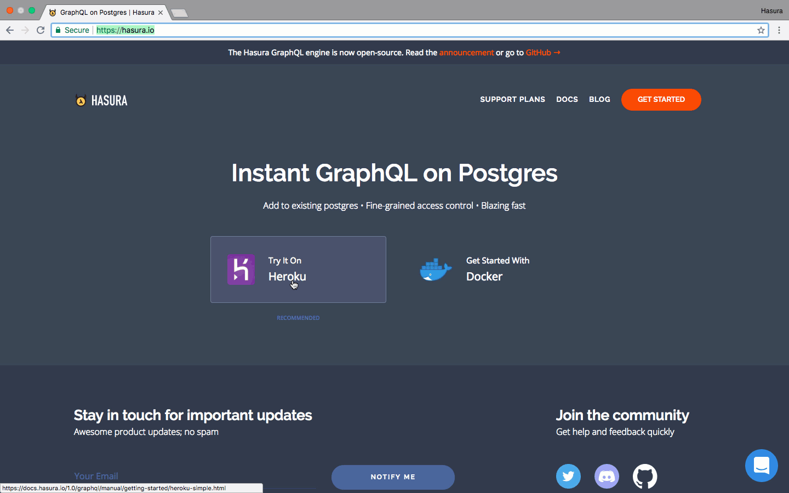
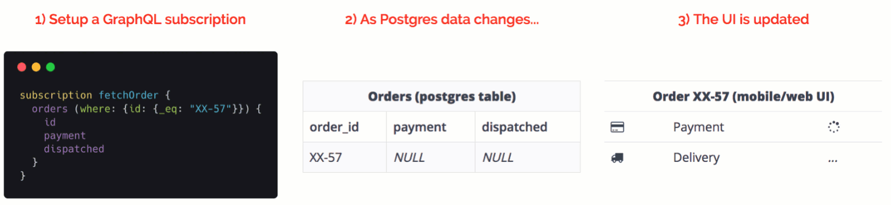
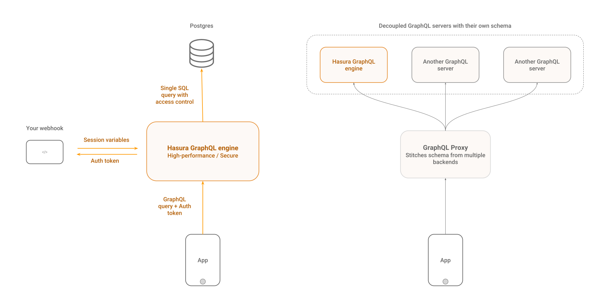

# Hasura GraphQL 엔진

[](https://docs.hasura.io)
[](https://circleci.com/gh/hasura/graphql-engine)


<a href="https://discord.gg/vBPpJkS"></a>
<a href="https://twitter.com/intent/follow?screen_name=HasuraHQ"></a>
<a href="https://eepurl.com/dBUfJ5"></a>

Hasura GraphQL Engine은 데이터베이스 이벤트를 [**웹훅 트리거**](../event-triggers.md)로 제공하고 비즈니스로직을 위한 원격 스키마와 함께 **Postgres를 통한 즉각적이고 실시간 GraphQL API** 를 제공하는 초고속 GraphQL 서버입니다.

Hasura는 Postgres를 지원하는 GraphQL 앱을 만들거나 Postgres를 사용하는 기존 응용 프로그램을 GraphQL로 서서히 옮길수있게 제공합니다.

자세한 내용은 [hasura.io](https://hasura.io)에서 읽어보거나 [도큐먼트](https://docs.hasura.io)를 참고하세요.

------------------



------------------



-------------------

## 특징들

* **강력한 쿼리를 만들기**: 내장 필터링, pagination, 패턴 서칭, 대량 insert, update , delete 뮤테이션 지원
* **실시간**: subscription을 사용하여 GraphQL 쿼리를 라이브 쿼리로 변환 가능
* **원격 스키마 머지(병합)**: 비즈니스 로직을 잇는 단일 GraphQL 엔진 엔드포인트를 위한 커스텀 graphQL 스키마 액세스 가능 [**더 많은 정보는 여기로**](../remote-schemas.md).
* **웹훅 또는 서버리스 function 트리거**: Postgres 에서 insert/update/delete 이벤트들을 지원 ([더 많은 정보는 여기로](../event-triggers.md))
* **실체적이고 라이브 데이터베이스와 작업**: 즉시 사용 가능한 GraphQL API 얻기 위한 Postgres database 포인팅 
* **세분화된 엑세스 제어**: 인증 시스템과 통합된 동적 액세스 제어(예: auth0, firebase-auth)
* **고성능& 낮은 footprint**: 최대 15MB 도커 이미지와 50MB 메모리 그리고 1000 req/s와 멀티코어 지원
* **어드민 UI 제공& 마이그레이션**: 어드민 UI와 Rails-inspired 스키마 마이그레이션 지원
* **Postgres** ❤️: Postgres 타입 지원 (PostGIS/geo-location, 등등..), 뷰를 *그래프*로 변환, mutation이 있는 저장된 function 또는 프로시저 trigger 를 지원

자세한 내용은 [hasura.io](https://hasura.io)에서 읽어보거나 [도큐먼트](https://docs.hasura.io)를 참고하세요.

## 목차
<!-- markdown-toc start - Don't edit this section. Run M-x markdown-toc-refresh-toc -->
**목차**

- [퀵 스타트:](#퀵스타트)
    - [Heroku에서 한번에 배포하기](#Heroku에서_한번에_배포하기)
    - [다른 배포 방법들](#다른_배포_방법들)
- [구조](#구조)
- [클라이언트 툴](#GraphQL_클라이언트)
- [비즈니스 로직 추가하기](#비즈니스_로직_추가하기)
    - [원격 스키마](#원격_스키마)
    - [데이터 베이스 이벤트에서 웹훅 트리거](#데이터베이스_이벤트에서_웹훅_트리거)
- [데모](#데모)
    - [실시간 어플리케이션](#리얼타임_어플리케이션)
    - [영상](#영상)
- [지원 및 트러뷸 슈팅](#지원__트러뷸슈팅)
- [컨트리뷰트](#기여)
- [브랜드 자산들](#브랜드_자산)
- [라이선](#라이선스)
- [번역](#번역)

<!-- markdown-toc end -->

## 퀵스타트:

### Heroku에서_한번에_배포하기

하수라를 가장 빨리 시작하는 방법은 Heroku를 사용하는거에요

1. 무료 Postgres 애드온와 함께 GraphQL Engine을 Heroku와 함께 배포하려면 다음 버튼을 클릭하세요

    [](https://heroku.com/deploy?template=https://github.com/hasura/graphql-engine-heroku)

2. Hasura 콘솔 열기

   `https://<app-name>.herokuapp.com` (*반드시 \<app-name\> 을 당신의 앱 이름으로 바꿔야합니다.*) 에 들어가서 어드민 콘솔을 여세요.

3. 첫 GraphQL query 만들기

   테이블을 만들고 당신의 첫번째 쿼리를 즉시 실행하세요. 이 가이드를 통해서 참고하세요 [simple guide](https://docs.hasura.io/1.0/graphql/manual/getting-started/first-graphql-query.html).

### 다른_원클릭_배포_방법들

원클릭 배포 옵션에 대한 사항들을 확인하세요.

| **인프라 제공** | **원클릭 링크** | **추가 정보** |
|:------------------:|:------------------------------------------------------------------------------------------------------------------------------------------------------------------------------------------------------------------------------------------------------------------:|:-------------------------------------------------------------------------------------------------------------------------------------------------:|
| DigitalOcean | [](https://marketplace.digitalocean.com/apps/hasura?action=deploy&refcode=c4d9092d2c48&utm_source=hasura&utm_campaign=readme) | [docs](https://docs.hasura.io/1.0/graphql/manual/guides/deployment/digital-ocean-one-click.html#hasura-graphql-engine-digitalocean-one-click-app) |
| Azure | [](https://portal.azure.com/#create/Microsoft.Template/uri/https%3a%2f%2fraw.githubusercontent.com%2fhasura%2fgraphql-engine%2fstable%2finstall-manifests%2fazure-container-with-pg%2fazuredeploy.json) | [docs](https://docs.hasura.io/1.0/graphql/manual/guides/deployment/azure-container-instances-postgres.html) |

### 다른_배포_방법들

Docker 기반 배포 와 고급 설정 옵션들은 [배포](https://docs.hasura.io/1.0/graphql/manual/getting-started/index.html) 혹은 [manifests 설치](../install-manifests) 에서 확인하실수있습니다.

## 구조

Hasura GraphQL Engine은 Postgres 데이터베이스 인스턴스를 전송하고 클라이언트 앱의 GraphQL 요청을 받을수있습니다. 기존 인증 시스템과 함께 작동하도록 구성할 수 있으며, 인증 시스템의 동적 변수를 사용하여 필드 레벨 규칙을 사용하여 액세스 제어를 처리할 수 있어요.

또한 원격 GraphQL 스키마를 머지(병합) 할수있으며 통합된 GraphQL API를 제공할수있어요.



## GraphQL_클라이언트

Hasura 는 모든 GraphQL 클라이언트에서 동작합니다. 저희는 [Apollo Client](https://github.com/apollographql/apollo-client) 를 사용할것을 추천드립니다. 다른 멋진 graphql 클라이언트들을 보고싶다면 [awesome-graphql](https://github.com/chentsulin/awesome-graphql) 에서 확인하세요 

## 비즈니스_로직_추가하기

GraphQL 엔진은 easy-to-reason, 확장성와 백엔드에 사용자 정의 비즈니스 로직을 추가하는 실용적인 방법을 제공해:

### 원격_스키마

원격 스키마에 Hasura의 Postgres 기반 GraphQL 스키마 외에 사용자 정의 확인기를 추가하십시오. 결제 API 구현 또는 데이터베이스에 없는 데이터 쿼리와 같은 사용 사례에 적합해요. - [더 많은 정보](../remote-schemas.md).

### 데이터베이스_이벤트에서_웹훅_트리거

데이터베이스 이벤트 기반으로 트리거 되는 비동기 로직을 추가하세요
알림이나 notification, Postgres의 데이터 파이프라인 혹은 비동기 프로세싱에 이상적이에요. - [더 많은 정보](../event-triggers.md).

### 파생_데이터_혹은_데이터_변환

Postrgres에서 데이터를 변환하거나 GraphQL Engine 에 쿼리를 요청할수있는 파생된 다른 데이터 셋을 이용한 비즈니스 로직을 돌릴수있어요. - [더 많은 정보](https://docs.hasura.io/1.0/graphql/manual/queries/derived-data.html).

## 데모

모든 예시 어플리케이션 보고싶으시다면 [hasura/sample-apps](https://github.com/hasura/sample-apps/tree/main) 디렉토리에서 확인하세요.


### 리얼타임_어플리케이션

- React 기반으로 만든 그룹챗 어플리케이션, typing indicator를 포함한, 온라인 유저 & 메세지 수신 알람
  - [Try it out](https://realtime-chat.demo.hasura.io/)
  - [Tutorial](https://github.com/hasura/sample-apps/tree/main/realtime-chat)
  - [Browse APIs](https://realtime-chat.demo.hasura.io/console)

- 달리는 차량 에서 현재 GPS 위치를 지도에 실시간으로 보여주는 위치 트래킹 앱
  - [Try it out](https://realtime-location-tracking.demo.hasura.io/)
  - [Tutorial](https://github.com/hasura/sample-apps/tree/main/realtime-location-tracking)
  - [Browse APIs](https://realtime-location-tracking.demo.hasura.io/console)

- 지속적으로 변화되는 데이터를 집계하는 리얼타임 대시보드
  - [Try it out](https://realtime-poll.demo.hasura.io/)
  - [Tutorial](https://github.com/hasura/sample-apps/tree/main/realtime-poll)
  - [Browse APIs](https://realtime-poll.demo.hasura.io/console)

### 영상

* [개인 호스트 gitlab 인스턴스에 GraphQL 추가하기](https://www.youtube.com/watch?v=a2AhxKqd82Q) (*3:44 분*)
* [Auth0와 GraphQL 백엔드가 있는 Todo app](https://www.youtube.com/watch?v=15ITBYnccgc) (*4:00 분*)
* [GitLab 인증과 통합된 GitLab의 GraphQL](https://www.youtube.com/watch?v=m1ChRhRLq7o) (*4:05 분*)
* [천만대의 탈것와 위치기반(PostGIS, Timescale) 을 위한 대시보드](https://www.youtube.com/watch?v=tsY573yyGWA) (*3:06 분*)


## 지원__트러뷸슈팅

문서와 커뮤니티는 대부분의 트러뷸 슈팅을 해결하는데 도움을 줄겁니다. 만약 버그를 발견했거나 저희의 도움이 필요하다면 아래 첨부된 채널중 하나로 연락 해주세요

* 지원 & 피드백: [Discord](https://discord.gg/vBPpJkS)
* 이슈 & 버그 트래커: [GitHub issues](https://github.com/hasura/graphql-engine/issues)
* 프로덕트 업데이트: [@HasuraHQ](https://twitter.com/hasurahq)
* Talk to us on our [website chat](https://hasura.io)
* 저희 [웹사이트](https://hasura.io) 에서 대화할수있어요

저희는 개방적이고 환영받는 커뮤니티 환경을 조성하는데 최선을 다하고 있습니다. 더 많은 커뮤니티 가이드를 보고 싶으시다면 [행동 강령](../code-of-conduct.md) 를 참고해주세요.

만약 보안이슈에 대해 리포트를 하고싶으시다면, [이것](../SECURITY.md)을 봐주세요.

## 기여

자세한 정보는 [컨트리뷰트 가이드](../CONTRIBUTING.md) 에서 확인하실수 있습니다.

## 브랜드_자산

Hasura 브랜드 자산 (로고, 하수라 마스코트, 뱃지 등등.) 은 [애셋/브랜드](../assets/brand) 폴더에서 찾을수있어요.
이것들을 당신의 어플리케이션, 웹사이트에 마음껏 쓰세요. 
만약 Hasura로 만든 어플리케이션에 "Powered by Hasura" 배지를 넣어주신다면 저희는 더 감격스러울것 같아요 ❤️

<div style="display: flex;">
  
  
</div>

```html
<!-- For light backgrounds -->
<a href="https://hasura.io">
  
</a>

<!-- For dark backgrounds -->
<a href="https://hasura.io">
  
</a>
```

## 라이선스

GraphQL Engine core 는 [아파치 라이선스 2.0](https://www.apache.org/licenses/LICENSE-2.0) (Apache-2.0)로 적용이됩니다.

모든 **다른 컨텐츠들은** ([`server`](../server), [`cli`](../cli) 그리고 [`console`](../console) 디렉토리를 제외한) 모든것들은 [MIT 라이선스](../LICENSE-community)로 적용이 됩니다.
이건 [`docs`](../docs) 와 [`community`](../community) 내에 있는 모든것들도 포함이 됩니다.

## 번역

이 readme 는 다른 번역으로 제공됩니다. :

- [Japanese :jp:](../translations/README.japanese.md) (:pray: [@moksahero](https://github.com/moksahero))
- [French :fr:](../translations/README.french.md) (:pray: [@l0ck3](https://github.com/l0ck3))
- [Bosnian :bosnia_herzegovina:](../translations/README.bosnian.md) (:pray: [@hajro92](https://github.com/hajro92))
- [Russian :ru:](../translations/README.russian.md) (:pray: [@highflyer910](https://github.com/highflyer910))
- [Greek 🇬🇷](../translations/README.greek.md) (:pray: [@MIP2000](https://github.com/MIP2000))
- [Spanish 🇲🇽](../translations/README.mx_spanish.md)(:pray: [@ferdox2](https://github.com/ferdox2))
- [Indonesian :indonesia:](../translations/README.indonesian.md) (:pray: [@anwari666](https://github.com/anwari666))
- [Brazilian Portuguese :brazil:](../translations/README.portuguese_br.md) (:pray: [@rubensmp](https://github.com/rubensmp))
- [German 🇩🇪](../translations/README.german.md) (:pray: [@FynnGrandke](https://github.com/FynnGrandke))
- [Chinese :cn:](../translations/README.chinese.md) (:pray: [@jagreetdg](https://github.com/jagreetdg) & [@johnbanq](https://github.com/johnbanq))
- [Korean :kr:](../translations/README.korean.md) (:pray: [@라스크](https://github.com/laskdjlaskdj12))

이문서의 다른 번역을 보고 싶다면 [여기](../translations) 를 참고하세요.
