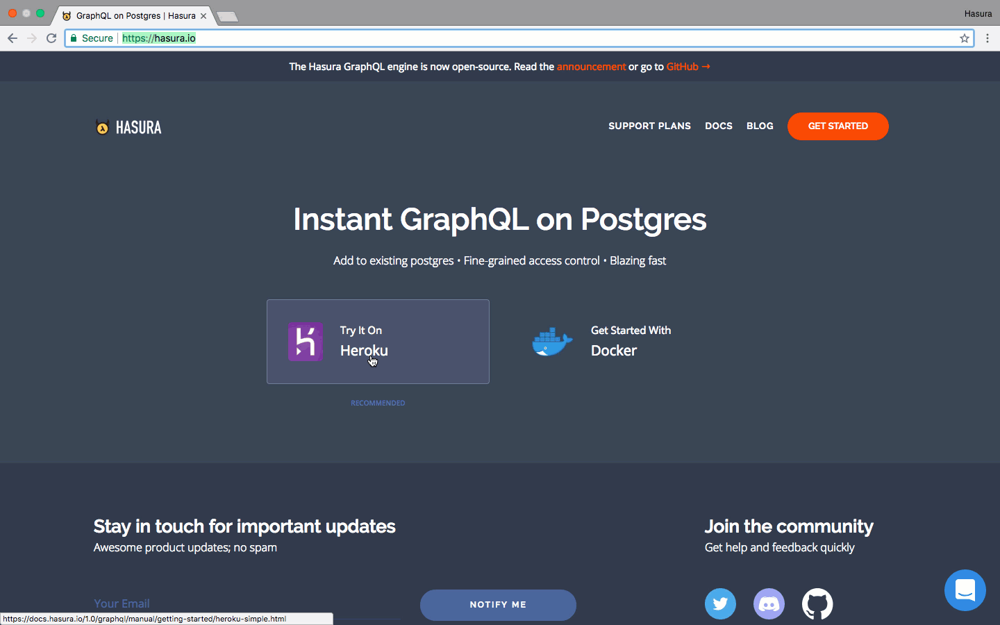
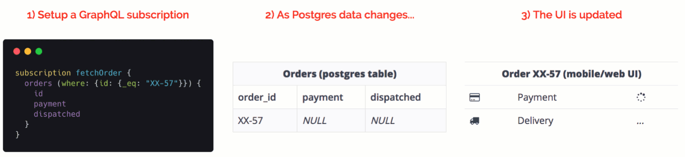
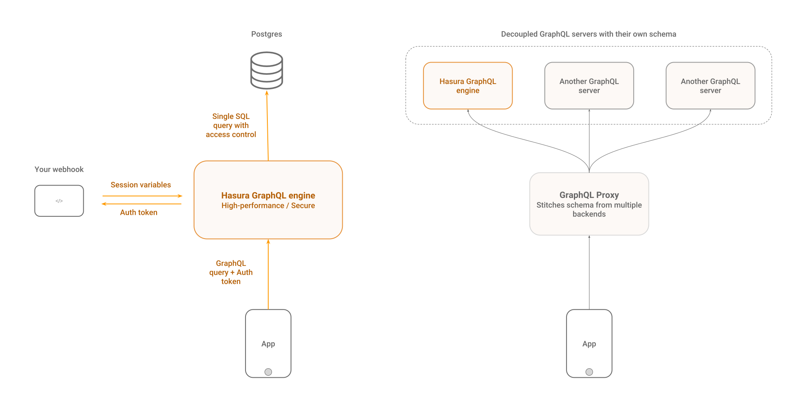

# Hasura GraphQL Engine

[](https://docs.hasura.io)
[](https://circleci.com/gh/hasura/graphql-engine)


<a href="https://discord.gg/vBPpJkS"></a>
<a href="https://twitter.com/intent/follow?screen_name=HasuraHQ"></a>
<a href="https://eepurl.com/dBUfJ5"></a>

Hasura GraphQL Engine, veritaban olaylarında webhook tetikleyici ve iş mantığı için uzaktan şemalar ile size **Postgres üzerinden anında, gerçek zamanlı GraphQL API**'leri sağlayan hızlı bir GraphQL sunucusudur.

Hasura, Postgres tarafından desteklenen GraphQL uygulamaları yaratmanıza veya Postgres kullanan mevcut uygulamaları aşamalı olarak GraphQL'e geçmenize yardımcı olur.

Daha fazla bilgiyi [hasura.io](https://hasura.io) ve [dökümanda](https://docs.hasura.io) bulabilirsiniz

------------------



------------------



-------------------

## Özellikler

* **Güçlü sorgular yapın**: Dahili filtreleme, sayfalandırma, model arama, yığın ekleme, güncelleme, mutasyonları silme
* **Gerçek zamanlı**: Abonelikleri kullanarak herhangi bir GraphQL sorgusunu canlı sorguya dönüştürme
* **Uzaktan şemaları birleştirme**: Tek bir GraphQL Engine uç noktası üzerinden iş mantığı için özel GraphQL şemalarına erişin.[**Daha fazla**](../remote-schemas.md).
* **Webhooks ve sunucusuz işlevleri tetikleme**: Postgres insert/update/delete olaylarında ([daha fazla](../event-triggers.md))
* **Mevcut, canlı veritabanlarıyla çalışır**: Kullanıma hazır bir GraphQL API'si almak için mevcut bir Postgres veritabanına yönlendirin
* **Hassas erişim kontrolü**: Kimlik doğrulama sisteminizle birleşen dinamik erişim kontrolü (örn: auth0, firebase-auth)
* **Yüksek performans ve az yer kaplama**: ~15mb Docker imaji; ~50MB RAM içinde saniyede 1000 sorgu; çoklu çekirdek farkındalığı
* **Yönetici Kullanıcı Arayüzü ve Taşıma İşlemleri**: Yönetici arayüzü ve Rails'den ilham alan şema taşıma işlemleri
* **Postgres** ❤️: Postgres türlerini (PostGIS/geo-location vb.) destekler, görünümleri grafiklere dönüştürür, depolanmış fonksiyonları veya mutasyonlu prosedürleri tetikler

Daha fazla bilgiyi [hasura.io](https://hasura.io) ve [dökümanda](https://docs.hasura.io) bulabilirsiniz

## İçerikler
<!-- markdown-toc start - Don't edit this section. Run M-x markdown-toc-refresh-toc -->
**İçerikler**

- [Hızlı Başlangıç:](#hızlı-başlangıç)
    - [Tek tıklamayla Heroku'ya deploy etme](#tek-tıklama-ile-herokuya-deploy-etme)
    - [Diğer deploy etme yöntemleri](#diğer-deploy-etme-yöntemleri)
- [Yapı](#yapı)
- [İstemci tarafı takımlar](#i̇stemci-tarafı-takımlar)
- [İş mantığı ekleme](#i̇ş-mantığı-ekleme)
    - [Uzak şemalar](#uzak-şemalar)
    - [Veritabanı olaylarındaki webhooks tetikleme](#veritabanı-olaylarındaki-webhooks-tetikleme)
- [Demolar](#demolar)
    - [Gerçek zamanlı uygulamalar](#gerçek-zamanlı-uygulamalar)
    - [Videolar](#videolar)
- [Destek ve sorun giderme](#destek-ve-sorun-giderme)
- [Katkıda bulunmak](#katkıda-bulunmak)
- [Marka varlıkları](#marka-varlıkları)
- [Lisans](#lisans)
- [Çeviriler](#çeviriler)

<!-- markdown-toc end -->

## Hızlı Başlangıç:

### Tek tıklama ile Heroku'ya deploy etme

Hasura'yı denemenin en hızlı yolu Heroku'dur.

1. Ücretsiz Postgre eklentisiyle Heroku'da GraphQL Engine'i kurmak için aşağıdaki düğmeye tıklayın.

    [](https://heroku.com/deploy?template=https://github.com/hasura/graphql-engine-heroku)

2. Hasura Console'u açın.

   Yönetici konsolunu açmak için `https://<app-name>.herokuapp.com` (*\<app-name\>'i uygulama adınızla değiştirin.*) adresini ziyaret edin.

3. İlk GraphQL sorgunuzu yapın.

   Bir tablo oluşturun ve ilk sorgunuzu hemen çalıştırın. Bunu takip edebilirsin [basit rehber](https://docs.hasura.io/1.0/graphql/manual/getting-started/first-graphql-query.html).

### Diğer tek tıklamayla deploy etme seçenekleri

Tek tıklamayla deploy etme seçenekleri için aşağıdaki talimatları takip edin:

| **Sağlayıcı** | **Tek tıklama linki** | **Ek bilgi** |
|:------------------:|:------------------------------------------------------------------------------------------------------------------------------------------------------------------------------------------------------------------------------------------------------------------:|:-------------------------------------------------------------------------------------------------------------------------------------------------:|
| DigitalOcean | [](https://marketplace.digitalocean.com/apps/hasura?action=deploy&refcode=c4d9092d2c48&utm_source=hasura&utm_campaign=readme) | [doküman](https://docs.hasura.io/1.0/graphql/manual/guides/deployment/digital-ocean-one-click.html#hasura-graphql-engine-digitalocean-one-click-app) |
| Azure | [](https://portal.azure.com/#create/Microsoft.Template/uri/https%3a%2f%2fraw.githubusercontent.com%2fhasura%2fgraphql-engine%2fmaster%2finstall-manifests%2fazure-container-with-pg%2fazuredeploy.json) | [doküman](https://docs.hasura.io/1.0/graphql/manual/guides/deployment/azure-container-instances-postgres.html) |

### Diğer deploy etme yöntemleri

Docker tabanlı dağıtım ve gelişmiş yapılandırma seçenekleri için [deployment
guides](https://docs.hasura.io/1.0/graphql/manual/getting-started/index.html) ya da 
[install manifests](../install-manifests) bakınız.

## Yapı

Hasura GraphQL Engine, bir Postgres veritabanı örneğinin önünde durur ve istemci uygulamalarınızdan GraphQL isteklerini kabul edebilir. Mevcut kimlik doğrulama sisteminizle çalışacak şekilde yapılandırılabilir ve kimlik doğrulama sisteminizden dinamik değişkenlerle alan düzeyinde kurallar kullanarak erişim denetimini işleyebilir. 

Ayrıca uzaktan GraphQL şemalarını birleştirebilir ve birleşik GraphQL API'si sağlayabilirsiniz.



## İstemci tarafı takımlar

Hasura herhangi bir GraphQL istemcisi ile çalışır. [Apollo Client](https://github.com/apollographql/apollo-client) kullanmanızı öneririz. İstemci listesi için [awesome-graphql](https://github.com/chentsulin/awesome-graphql) adresine bakınız.

## İş mantığı ekleme

GraphQL Engine, backend'inize özel iş mantığı eklemek için kolay anlaşılır, ölçeklenebilir ve yüksek performanslı yöntemler sunar: 

### Uzak Şemalar

Hasura'nın Postgres tabanlı GraphQL şemasına ek olarak uzak bir şemada özel çözümleyiciler ekleyin. Bir ödeme API'sini uygulamak veya veritabanınızda bulunmayan verileri sorgulamak gibi kullanım durumları için idealdir. - [daha fazla](../remote-schemas.md).

### Veritabanı olaylarındaki webhooks tetikleme

Veritabanı olaylarına göre tetiklenen eşzamansız iş mantığını ekleyin.
Bildirimler, Postgres veri  hatları veya asenkron işleme için idealdir - [daha fazla](../event-triggers.md).

### Türetilmiş veri veya veri dönüşümleri

Postgres'te verileri dönüştürün veya GraphQL Engine kullanılarak sorgulanabilecek başka bir veri kümesi türetmek için iş mantığı çalıştırın. - [daha fazla](https://docs.hasura.io/1.0/graphql/manual/queries/derived-data.html).

## Demolar

[hasura/sample-apps](https://github.com/hasura/sample-apps/tree/main) dizinindeki örnek uygulamalara göz atın.

### Gerçek zamanlı uygulamalar

- React ile oluşturulmuş grup sohbet uygulaması. Yazma belirteci, çevrimiçi kullanıcılar ve yeni mesaj bildirimleri içerir.
  - [Deneyin](https://realtime-chat.demo.hasura.io/)
  - [Rehber](https://github.com/hasura/sample-apps/tree/main/realtime-chat)
  - [APİ'lere göz atın](https://realtime-chat.demo.hasura.io/console)

- Bir harita üzerinde hareket eden mevcut GPS koordinatlarını değiştiren, çalışan bir aracı gösteren canlı konum izleme uygulaması.
  - [Deneyin](https://realtime-location-tracking.demo.hasura.io/)
  - [Rehber](https://github.com/hasura/sample-apps/tree/main/realtime-location-tracking)
  - [APİ'lere göz ayın](https://realtime-location-tracking.demo.hasura.io/console)

- Sürekli değişen veriler üzerinde veri toplama için gerçek zamanlı bir kontrol paneli.
  - [Deneyin](https://realtime-poll.demo.hasura.io/)
  - [Rehber](https://github.com/hasura/sample-apps/tree/main/realtime-poll)
  - [APİ'lere göz atın](https://realtime-poll.demo.hasura.io/console)

### Videolar

* [Kendi kendine barındırılan bir GitLab örneğine GraphQL ekleme](https://www.youtube.com/watch?v=a2AhxKqd82Q) (*3:44 mins*)
* [Auth0 ve GraphQL backend'iyle todo uygulaması](https://www.youtube.com/watch?v=15ITBYnccgc) (*4:00 mins*)
* [GitLab auth ile entegre edilmiş GitLab üzerinde GraphQL](https://www.youtube.com/watch?v=m1ChRhRLq7o) (*4:05 mins*)
* [Coğrafi konumlu 10 milyon sürüş için gösterge tablosu (PostGIS, Timescale)](https://www.youtube.com/watch?v=tsY573yyGWA) (*3:06 mins*)


## Destek ve sorun giderme
Belgeler ve topluluk, çoğu sorunu gidermenize yardımcı olacaktır. Bir hatayla karşılaştıysanız veya bizimle iletişime geçmeniz gerekiyorsa aşağıdaki kanallardan birini kullanarak bizimle iletişime geçebilirsiniz: 

* Destek ve geri bildirim: [Discord](https://discord.gg/vBPpJkS)
* Sorun ve hata bildirme: [GitHub issues](https://github.com/hasura/graphql-engine/issues)
* Ürün güncellemelerini takip edin: [@HasuraHQ](https://twitter.com/hasurahq)
* Bizimle konuşun: [website chat](https://hasura.io)

Toplulukta açık ve hoş bir ortam yaratmaya kararlıyız. Lütfen [Davranış Kodu](../code-of-conduct.md) adresine bakınız

Bir güvenlik sorununu bildirmek istiyorsanız lütfen [bunu okuyun](../SECURITY.md).

## Katkıda bulunmak

Daha fazla detay için [katkıda bulunma kuralını](../CONTRIBUTING.md) kontrol edin.

## Marka varlıkları

Hasura marka varlıkları (logolar, Hasura maskotu, rozetler vb.) [assets/brand](../assets/brand) klasöründedir. Bunları uygulamanızda/websitenizde kullanmaktan çekinmeyin. Hasura kullanılarak oluşturduğunuz uygulamalarınıza "Powered by Hasura" işareti eklerseniz çok seviniriz. ❤️

<div style="display: flex;">
  
</div>

```html
<!-- Beyaz arkaplan için -->
<a href="https://hasura.io">
  
</a>

<!-- Siyah arkaplan için -->
<a href="https://hasura.io">
  
</a>
```

## Lisans

Çekirdek GraphQL Engine [Apache License 2.0](https://www.apache.org/licenses/LICENSE-2.0) (Apache-2.0) altında bulunur.

**Diğer tüm içerikler** ([`sunucu`](../server), [`cli`](../cli) ve
[`konsol`](../console) dizinleri hariç) [MIT License](../LICENSE-community) altındadır.
Buna, [`doküman`](../docs) ve [`topluluk`](../community) dizinleri içindeki her şey dahildir.

## Çeviriler

Bu Readme sayfası aşağıdaki çevirilerde mevcuttur:

- [Japonca :jp:](./README.japanese.md) (:pray: [@moksahero](https://github.com/moksahero))
- [Fransızca :fr:](./README.french.md) (:pray: [@l0ck3](https://github.com/l0ck3))
- [Boşnakça :bosnia_herzegovina:](./README.bosnian.md) (:pray: [@hajro92](https://github.com/hajro92))
- [Rusca :ru:](./README.russian.md) (:pray: [@highflyer910](https://github.com/highflyer910))
- [Yunanca 🇬🇷](./README.greek.md) (:pray: [@MIP2000](https://github.com/MIP2000))
- [İspanyolca 🇲🇽](./README.mx_spanish.md)(:pray: [@ferdox2](https://github.com/ferdox2))
- [Endonezyaca :indonesia:](./README.indonesian.md) (:pray: [@anwari666](https://github.com/anwari666))
- [Brezilya Portekizcesi :brazil:](./README.portuguese_br.md) (:pray: [@rubensmp](https://github.com/rubensmp))
- [Almanca 🇩🇪](./README.german.md) (:pray: [@FynnGrandke](https://github.com/FynnGrandke))
- [Çince :cn:](./README.chinese.md) (:pray: [@jagreetdg](https://github.com/jagreetdg) & [@johnbanq](https://github.com/johnbanq))
- [Korece :kr:](./README.korean.md) (:pray: [@라스크](https://github.com/laskdjlaskdj12))

Diğer dosyalar için çeviriler [burada](./) bulunabilir.
